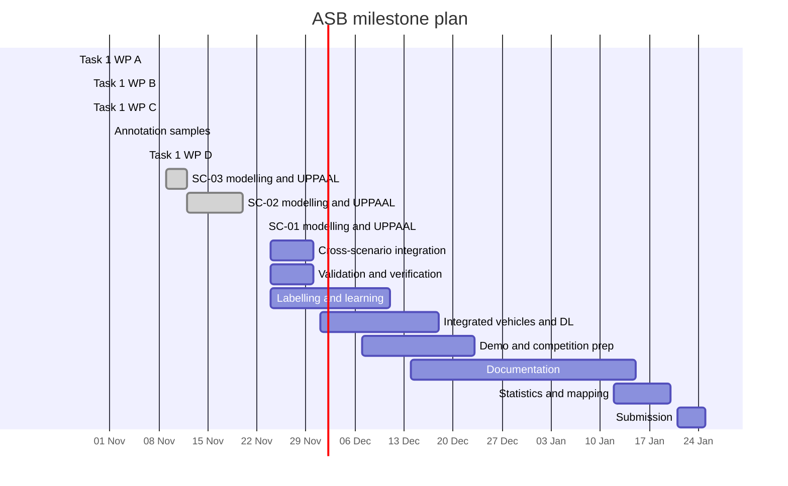

# Autonomous Systems B — Project Gantt

> Baseline reviewed 23 November 2026. Completed work is based on task-log/commit evidence; future dates are estimates.

## Task table
See [gantt_tasks.csv](gantt_tasks.csv) for owners, status, dates, and evidence notes.

## Evidence/assumptions
- Task 1 records follow `documentation/TASK_LOG.md`.
- Scenario progress is based on commit evidence reviewed for the repository.
- Future tasks are planning estimates, not confirmed completion dates.
- The automation refreshes the commit feed; task status is not inferred from commits.

## Recent commits
This section is automatically refreshed daily by GitHub Actions.
