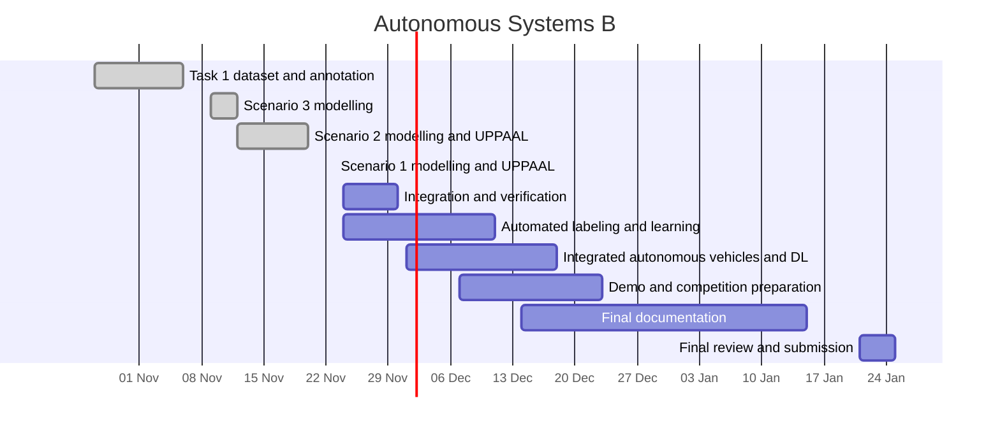

# Precision Farming — Autonomous Systems B

Team repository for the **Autonomous Systems B (ASB)** precision-farming project at Hochschule Hamm-Lippstadt.

The project explores autonomous systems in precision agriculture, with a focus on field observation, weed detection, task coordination, autonomous treatment, and safe recovery.

## Project status and timeline

The timeline below is the high-level project plan. The [detailed Gantt](documentation/project_management/GANTT.md) includes task owners, dates, status and evidence notes and is automatically refreshed by GitHub Actions.

Project tracking links

- [Detailed Gantt chart](documentation/project_management/GANTT.md)
- [Task log](documentation/TASK_LOG.md)
- [Milestone schedule source](documentation/project_management/milestones.csv)
- [Documentation index](documentation/README.md)

## Repository structure

| Directory | Contents |
|---|---|
| `data/` | Field data, samples, and annotation datasets |
| `documentation/` | Requirements, scenario models, UPPAAL models, task log, papers, project tracking |
| `experiments/` | Annotation exports, comparison artefacts and evaluation |
| `notebooks/` | Coursework and analysis notebooks |
| `utils/` | Reusable utilities |

## Contribution

See [contribution.md](contribution.md).
