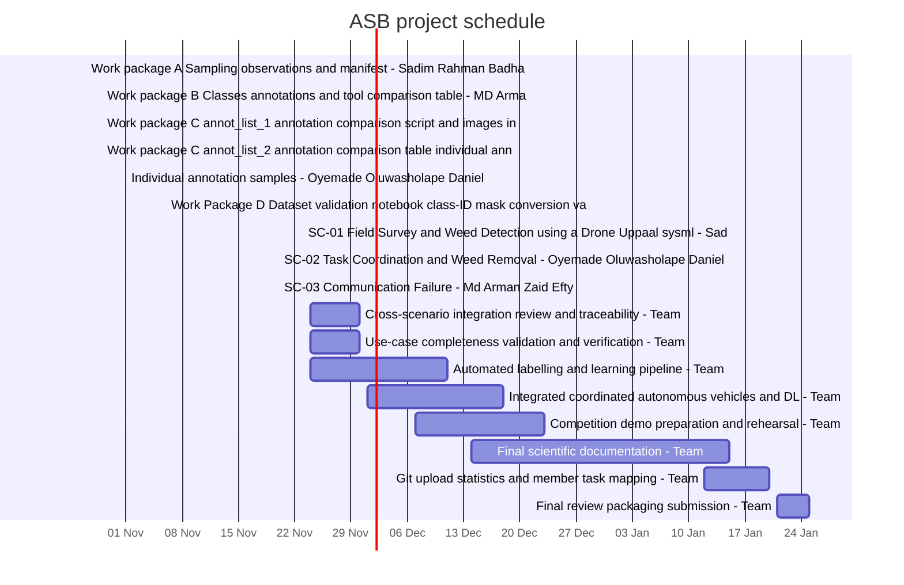

# Autonomous Systems B — Project Gantt

> Generated from documentation/TASK_LOG.md and milestones.csv. Completed work is read from the task log only; planned milestones are separate. No hardcoded scenario rows are added.

## Schedule

| Task | Owner | Start | End | Status | Notes |
|---|---|---|---|---|---|
| Work package A: Sampling, observations, and manifest | Sadim Rahman Badhan | 2026-10-27 | 2026-10-27 | done | Task 1 — Task log |
| Work package B: Classes, annotations, and tool comparison table | MD Arman Zaid Efty | 2026-10-29 | 2026-10-29 | done | Task 1 — Task log |
| Work package C: `annot_list_1`, annotation comparison (script and images), individual annotation samples | Sadim Rahman Badhan | 2026-10-29 | 2026-10-29 | done | Task 1 — Task log |
| Work package C: `annot_list_2`, annotation comparison table, individual annotation samples | Md Arman Zaid Efty | 2026-10-29 | 2026-10-29 | done | Task 1 — Task log |
| Individual annotation samples | Oyemade Oluwasholape Daniel | 2026-11-01 | 2026-11-01 | done | Task 1 — Task log |
| **Work Package D:** Dataset validation notebook, class-ID mask conversion, validation results, class distribution and source recording tables, segmentation overlays, dataset manifest, and dataset documentation(SugarBeet_WorkPackageD_Audit_DRAFT.zip). | Md Arman Zaid Efty | 2026-11-06 | 2026-11-06 | done | Task 1 — Task log |
| SC-01: Field Survey and Weed Detection using a Drone (Uppaal, sysml) | Sadim Rahman Badhan | 2026-11-23 | 2026-11-23 | done | Task 2: Scenario-based task — Task log |
| SC-02: Task Coordination and Weed Removal | Oyemade Oluwasholape Daniel | 2026-11-20 | 2026-11-20 | done | Task 2: Scenario-based task — Task log |
| SC-03: Communication Failure | Md Arman Zaid Efty | 2026-11-20 | 2026-11-20 | done | Task 2: Scenario-based task — Task log |
| Cross-scenario integration review and traceability | Team | 2026-11-24 | 2026-11-30 | planned | Planning estimate |
| Use-case completeness validation and verification | Team | 2026-11-24 | 2026-11-30 | planned | Planning estimate |
| Automated labelling and learning pipeline | Team | 2026-11-24 | 2026-12-11 | planned | Professor milestone planning |
| Integrated coordinated autonomous vehicles and DL | Team | 2026-12-01 | 2026-12-18 | planned | Professor milestone planning |
| Competition demo preparation and rehearsal | Team | 2026-12-07 | 2026-12-23 | planned | Planning estimate |
| Final scientific documentation | Team | 2026-12-14 | 2027-01-15 | planned | Planning estimate |
| Git upload statistics and member task mapping | Team | 2027-01-12 | 2027-01-20 | planned | Planning estimate |
| Final review packaging submission | Team | 2027-01-21 | 2027-01-25 | planned | Official final submission deadline |

## Timeline

## Recent commit activity

- 2026-11-23 [ebb5980](https://github.com/SamRB-dev/PrecisionFarming/commit/ebb5980e439eb125b93212e677f25cd5f288a8a4) — Remove duplicate scenario rows from Gantt generator
- 2026-11-23 [c3d1e2d](https://github.com/SamRB-dev/PrecisionFarming/commit/c3d1e2dab3d443e173cc599ad0c50997c76300c5) — chore: refresh project Gantt
- 2026-11-23 [982bc46](https://github.com/SamRB-dev/PrecisionFarming/commit/982bc464be803fa2453e8810e296bf3cb5b26d66) — Fix formatting in task log for consistent spacing
- 2026-11-23 [997d220](https://github.com/SamRB-dev/PrecisionFarming/commit/997d220398c02be02031034b329049d2ccb4e268) — Update task log with completed dates and add new task section for auto labelling/segmentation
- 2026-11-23 [a4941b7](https://github.com/SamRB-dev/PrecisionFarming/commit/a4941b70a0bfccb6c07bce1db2b2c1c79f68ebaf) — chore: refresh project Gantt
- 2026-11-23 [94ba674](https://github.com/SamRB-dev/PrecisionFarming/commit/94ba67446439263beb111c965fd2f034cceaa7bf) — Clarify Gantt evidence and contributor attribution
- 2026-11-23 [6eb08c4](https://github.com/SamRB-dev/PrecisionFarming/commit/6eb08c46ae0eaebda8d2acfaf3d68cb1a3abdd8b) — Fix Gantt table formatting and display contributor names
- 2026-11-23 [5da837b](https://github.com/SamRB-dev/PrecisionFarming/commit/5da837b07eec9efa24ea0f57d076d3c872b8436d) — chore: refresh project Gantt
- 2026-11-23 [c80c863](https://github.com/SamRB-dev/PrecisionFarming/commit/c80c863759fae6564b432f8ce5415f8d5f282525) — Fix Gantt workflow push race with retry and rebase
- 2026-11-23 [e2e79b8](https://github.com/SamRB-dev/PrecisionFarming/commit/e2e79b8e80d2fb78b216a486e459568ed14873e4) — Normalize scenario diagram filenames
- 2026-11-23 [84e6842](https://github.com/SamRB-dev/PrecisionFarming/commit/84e6842d676882d8e3cbf1c89d9f261b3c3ffde5) — Standardize scenario modelling documentation and show Gantt in README
- 2026-11-23 [06bfb09](https://github.com/SamRB-dev/PrecisionFarming/commit/06bfb09fe28d3100b3ca14e5cc0526dad100f532) — Add Gantt placeholder for automated generation

## Notes and evidence
- Completed entries and contributor names are parsed from the task tables in documentation/TASK_LOG.md.
- Task 3 rows with blank completion dates are intentionally excluded from the completed schedule.
- Planned milestones come from milestones.csv and are not represented as completed.
- Scenario work appears once only; no hardcoded scenario dates are appended.
- GitHub Actions regenerates this file.
