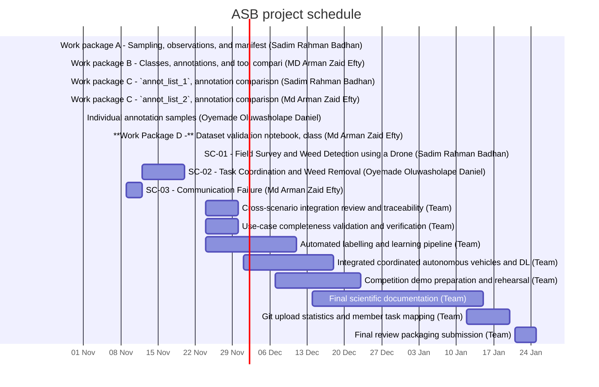

# Autonomous Systems B — Project Gantt

> Generated from the task log, scenario assignment/commit evidence, milestones.csv, and recent commit history. Forward-looking dates are estimates unless identified as official.

## Schedule

| Task | Owner | Start | End | Status | Notes |
|---|---|---|---|---|---|
| Work package A: Sampling, observations, and manifest | Sadim Rahman Badhan | 2026-10-27 | 2026-10-27 | done | Task log |
| Work package B: Classes, annotations, and tool comparison table | MD Arman Zaid Efty | 2026-10-29 | 2026-10-29 | done | Task log |
| Work package C: `annot_list_1`, annotation comparison (script and images), individual annotation samples | Sadim Rahman Badhan | 2026-10-29 | 2026-10-29 | done | Task log |
| Work package C: `annot_list_2`, annotation comparison table, individual annotation samples | Md Arman Zaid Efty | 2026-10-29 | 2026-10-29 | done | Task log |
| Individual annotation samples | Oyemade Oluwasholape Daniel | 2026-11-01 | 2026-11-01 | done | Task log |
| **Work Package D:** Dataset validation notebook, class-ID mask conversion, validation results, class distribution and source recording tables, segmentation overlays, dataset manifest, and dataset documentation(SugarBeet_WorkPackageD_Audit_DRAFT.zip). | Md Arman Zaid Efty | 2026-11-06 | 2026-11-06 | done | Task log |
| SC-01: Field Survey and Weed Detection using a Drone | Sadim Rahman Badhan | 2026-11-23 | 2026-11-23 | evidence | Commit evidence on 23 Nov; completion date not confirmed in task log |
| SC-02: Task Coordination and Weed Removal | Oyemade Oluwasholape Daniel | 2026-11-12 | 2026-11-20 | evidence | Scenario-model/UPPAAL commit evidence; completion date not confirmed in task log |
| SC-03: Communication Failure | Md Arman Zaid Efty | 2026-11-09 | 2026-11-12 | evidence | Scenario-model/UPPAAL commit evidence; completion date not confirmed in task log |
| Cross-scenario integration review and traceability | Team | 2026-11-24 | 2026-11-30 | planned | Planning estimate |
| Use-case completeness validation and verification | Team | 2026-11-24 | 2026-11-30 | planned | Planning estimate |
| Automated labelling and learning pipeline | Team | 2026-11-24 | 2026-12-11 | planned | Professor milestone planning |
| Integrated coordinated autonomous vehicles and DL | Team | 2026-12-01 | 2026-12-18 | planned | Professor milestone planning |
| Competition demo preparation and rehearsal | Team | 2026-12-07 | 2026-12-23 | planned | Planning estimate |
| Final scientific documentation | Team | 2026-12-14 | 2027-01-15 | planned | Planning estimate |
| Git upload statistics and member task mapping | Team | 2027-01-12 | 2027-01-20 | planned | Planning estimate |
| Final review packaging submission | Team | 2027-01-21 | 2027-01-25 | planned | Official final submission deadline |

## Timeline

## Recent commit activity

- 2026-11-23 [94ba674](https://github.com/SamRB-dev/PrecisionFarming/commit/94ba67446439263beb111c965fd2f034cceaa7bf) — Clarify Gantt evidence and contributor attribution
- 2026-11-23 [6eb08c4](https://github.com/SamRB-dev/PrecisionFarming/commit/6eb08c46ae0eaebda8d2acfaf3d68cb1a3abdd8b) — Fix Gantt table formatting and display contributor names
- 2026-11-23 [5da837b](https://github.com/SamRB-dev/PrecisionFarming/commit/5da837b07eec9efa24ea0f57d076d3c872b8436d) — chore: refresh project Gantt
- 2026-11-23 [c80c863](https://github.com/SamRB-dev/PrecisionFarming/commit/c80c863759fae6564b432f8ce5415f8d5f282525) — Fix Gantt workflow push race with retry and rebase
- 2026-11-23 [e2e79b8](https://github.com/SamRB-dev/PrecisionFarming/commit/e2e79b8e80d2fb78b216a486e459568ed14873e4) — Normalize scenario diagram filenames
- 2026-11-23 [84e6842](https://github.com/SamRB-dev/PrecisionFarming/commit/84e6842d676882d8e3cbf1c89d9f261b3c3ffde5) — Standardize scenario modelling documentation and show Gantt in README
- 2026-11-23 [06bfb09](https://github.com/SamRB-dev/PrecisionFarming/commit/06bfb09fe28d3100b3ca14e5cc0526dad100f532) — Add Gantt placeholder for automated generation
- 2026-11-23 [f9c4261](https://github.com/SamRB-dev/PrecisionFarming/commit/f9c4261d517284a4115815129edbf1f75076a26f) — Organize project management and sync Gantt from task log
- 2026-11-23 [fd421a2](https://github.com/SamRB-dev/PrecisionFarming/commit/fd421a25fdd93bb0a0dda2577b2aed96cbd81941) — chore: refresh project Gantt
- 2026-11-23 [70133a7](https://github.com/SamRB-dev/PrecisionFarming/commit/70133a744dab9dd64d2b0417e51e75d83a0beec1) — Add project Gantt and auto-refresh workflow
- 2026-11-23 [f8698f3](https://github.com/SamRB-dev/PrecisionFarming/commit/f8698f3e49ae1f355c2bca5e43e6368387cf6d2a) — Add project Gantt and auto-refresh workflow
- 2026-11-23 [5f2e4ca](https://github.com/SamRB-dev/PrecisionFarming/commit/5f2e4ca45bca8e9fe8dd6265b5b8b482ff35a5c1) — Add project Gantt and auto-refresh workflow
- 2026-11-23 [415c10e](https://github.com/SamRB-dev/PrecisionFarming/commit/415c10ed410b2977d3bc9841ff700b469f04790c) — Add project Gantt and auto-refresh workflow
- 2026-11-23 [bb97128](https://github.com/SamRB-dev/PrecisionFarming/commit/bb971284b7c562a8a19b3194e6b16a61a016f4f2) — Add project Gantt and auto-refresh workflow
- 2026-11-23 [451536f](https://github.com/SamRB-dev/PrecisionFarming/commit/451536f4de7777dfe37545b177eb2f9c1bbd1181) — Merge branch 'main' of https://github.com/SamRB-dev/PrecisionFarming
- 2026-11-23 [e4dba09](https://github.com/SamRB-dev/PrecisionFarming/commit/e4dba09211ca2e531da12f779cebd0ea230c2768) — Refactor DroneSurvey UPPAAL model and add simulation results
- 2026-11-22 [2bbfe4b](https://github.com/SamRB-dev/PrecisionFarming/commit/2bbfe4b4839bdb111c5c2daa3c325dab1ffac251) — Updated original images
- 2026-11-20 [2807fbe](https://github.com/SamRB-dev/PrecisionFarming/commit/2807fbe940361195d551626ea86db534036b3820) — Updated activity diagram for scenario 2
- 2026-11-20 [952b546](https://github.com/SamRB-dev/PrecisionFarming/commit/952b546b09e14a6ceb0c84c3df9422e60a017fb2) — Merge pull request #8 from SamRB-dev/scenario-2-tractor
- 2026-11-20 [78e385a](https://github.com/SamRB-dev/PrecisionFarming/commit/78e385a6503025e0b403fe54f0277340723b93e8) — Add verified Scenario 2 UPPAAL model

## Evidence and assumptions
- Task 1 owners and completion dates are taken from documentation/TASK_LOG.md.
- Scenario owners are from the task log; displayed date ranges are commit-evidence windows, not confirmed completion dates.
- Planned milestone dates and status are maintained in milestones.csv.
- The daily GitHub Actions workflow regenerates this document.
