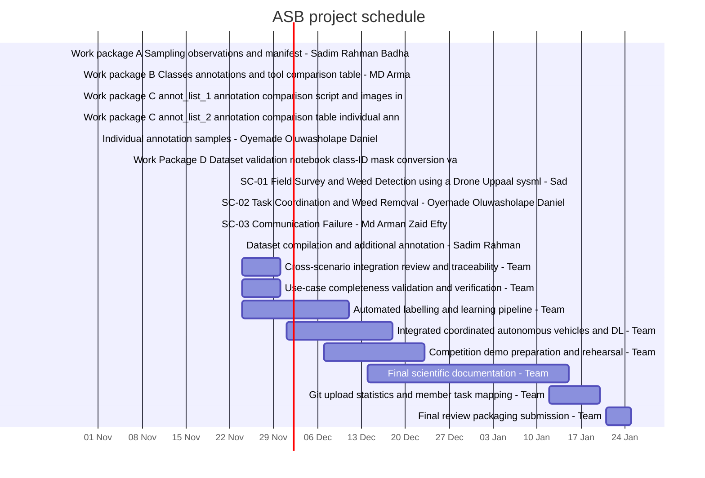

# Autonomous Systems B — Project Gantt

> Generated from documentation/TASK_LOG.md and milestones.csv. Completed work is read from the task log only; planned milestones are separate. No hardcoded scenario rows are added.

## Schedule

| Task | Owner | Start | End | Status | Notes |
|---|---|---|---|---|---|
| Work package A: Sampling, observations, and manifest | Sadim Rahman Badhan | 2026-10-27 | 2026-10-27 | done | Task 1 — Task log |
| Work package B: Classes, annotations, and tool comparison table | MD Arman Zaid Efty | 2026-10-29 | 2026-10-29 | done | Task 1 — Task log |
| Work package C: `annot_list_1`, annotation comparison (script and images), individual annotation samples | Sadim Rahman Badhan | 2026-10-29 | 2026-10-29 | done | Task 1 — Task log |
| Work package C: `annot_list_2`, annotation comparison table, individual annotation samples | Md Arman Zaid Efty | 2026-10-29 | 2026-10-29 | done | Task 1 — Task log |
| Individual annotation samples | Oyemade Oluwasholape Daniel | 2026-11-01 | 2026-11-01 | done | Task 1 — Task log |
| **Work Package D:** Dataset validation notebook, class-ID mask conversion, validation results, class distribution and source recording tables, segmentation overlays, dataset manifest, and dataset documentation(SugarBeet_WorkPackageD_Audit_DRAFT.zip). | Md Arman Zaid Efty | 2026-11-06 | 2026-11-06 | done | Task 1 — Task log |
| SC-01: Field Survey and Weed Detection using a Drone (Uppaal, sysml) | Sadim Rahman Badhan | 2026-11-23 | 2026-11-23 | done | Task 2: Scenario-based task — Task log |
| SC-02: Task Coordination and Weed Removal | Oyemade Oluwasholape Daniel | 2026-11-20 | 2026-11-20 | done | Task 2: Scenario-based task — Task log |
| SC-03: Communication Failure | Md Arman Zaid Efty | 2026-11-20 | 2026-11-20 | done | Task 2: Scenario-based task — Task log |
| Dataset compilation and additional annotation | Sadim Rahman | 2026-11-24 | 2026-11-24 | done | Task 3: Auto Labelling/Segmentation — Task log |
| Cross-scenario integration review and traceability | Team | 2026-11-24 | 2026-11-30 | planned | Planning estimate |
| Use-case completeness validation and verification | Team | 2026-11-24 | 2026-11-30 | planned | Planning estimate |
| Automated labelling and learning pipeline | Team | 2026-11-24 | 2026-12-11 | planned | Professor milestone planning |
| Integrated coordinated autonomous vehicles and DL | Team | 2026-12-01 | 2026-12-18 | planned | Professor milestone planning |
| Competition demo preparation and rehearsal | Team | 2026-12-07 | 2026-12-23 | planned | Planning estimate |
| Final scientific documentation | Team | 2026-12-14 | 2027-01-15 | planned | Planning estimate |
| Git upload statistics and member task mapping | Team | 2027-01-12 | 2027-01-20 | planned | Planning estimate |
| Final review packaging submission | Team | 2027-01-21 | 2027-01-25 | planned | Official final submission deadline |

## Timeline

## Recent commit activity

- 2026-11-24 [44a49e4](https://github.com/SamRB-dev/PrecisionFarming/commit/44a49e42041cdf25dd97a4b6c0976a3cdb69620e) — chore: refresh project Gantt
- 2026-11-24 [16a8e8d](https://github.com/SamRB-dev/PrecisionFarming/commit/16a8e8dd043e5f5b28e594161a873b23b7f2f0c0) — Record dataset compilation and additional annotation completion
- 2026-11-24 [95e4ecd](https://github.com/SamRB-dev/PrecisionFarming/commit/95e4ecd24dea7490e543b820b6bb4a20b153d4c0) — chore: refresh project Gantt
- 2026-11-24 [32639aa](https://github.com/SamRB-dev/PrecisionFarming/commit/32639aa758bf8ce1b0999000c9c16ce09a849102) — Assign additional annotation to Sadim Rahman
- 2026-11-24 [40d2f76](https://github.com/SamRB-dev/PrecisionFarming/commit/40d2f76b8af68f99fdba3a59d2d1dbdc64b5c2dd) — Update binary files in individual and mutual annotation samples
- 2026-11-24 [b1e5814](https://github.com/SamRB-dev/PrecisionFarming/commit/b1e581468560ab8f389ce3eba4bd7ca21c671c3c) — Add LFS tracking for new dataset zip files and update .gitattributes
- 2026-11-24 [253abad](https://github.com/SamRB-dev/PrecisionFarming/commit/253abad0e45f2230e698d509e8b1b653a0ec4e8b) — Add dataset builder and exclude large dataset archives
- 2026-11-24 [3e423f2](https://github.com/SamRB-dev/PrecisionFarming/commit/3e423f2625dc80687a65d5ef4c79ec271ccec2a2) — Add original.zip file for DJI_0104 annotation samples
- 2026-11-23 [1688955](https://github.com/SamRB-dev/PrecisionFarming/commit/16889552e5b5144ff3fe7b300a8afe4b13509eb7) — chore: refresh project Gantt
- 2026-11-23 [ebb5980](https://github.com/SamRB-dev/PrecisionFarming/commit/ebb5980e439eb125b93212e677f25cd5f288a8a4) — Remove duplicate scenario rows from Gantt generator
- 2026-11-23 [c3d1e2d](https://github.com/SamRB-dev/PrecisionFarming/commit/c3d1e2dab3d443e173cc599ad0c50997c76300c5) — chore: refresh project Gantt
- 2026-11-23 [982bc46](https://github.com/SamRB-dev/PrecisionFarming/commit/982bc464be803fa2453e8810e296bf3cb5b26d66) — Fix formatting in task log for consistent spacing

## Notes and evidence
- Completed entries and contributor names are parsed from the task tables in documentation/TASK_LOG.md.
- Task 3 rows with blank completion dates are intentionally excluded from the completed schedule.
- Planned milestones come from milestones.csv and are not represented as completed.
- Scenario work appears once only; no hardcoded scenario dates are appended.
- GitHub Actions regenerates this file.
